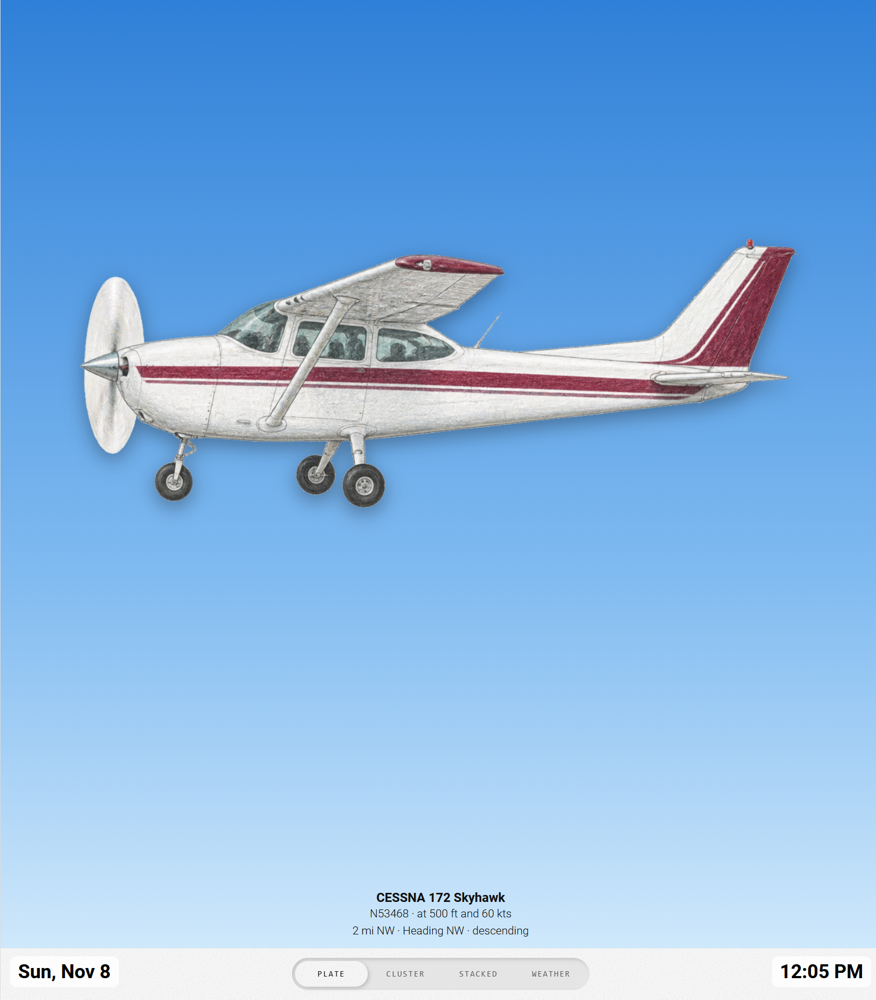
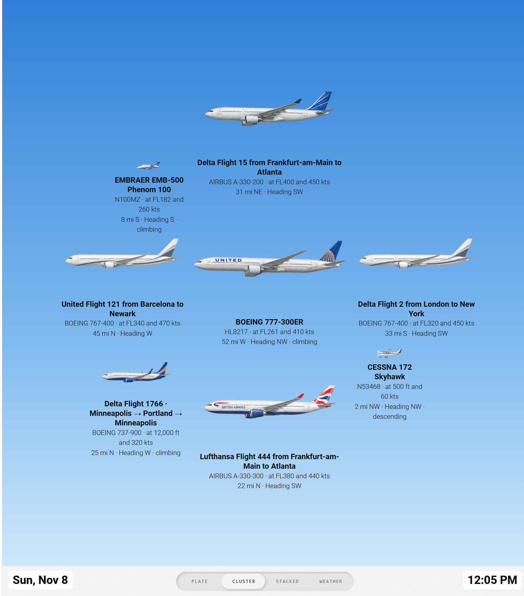
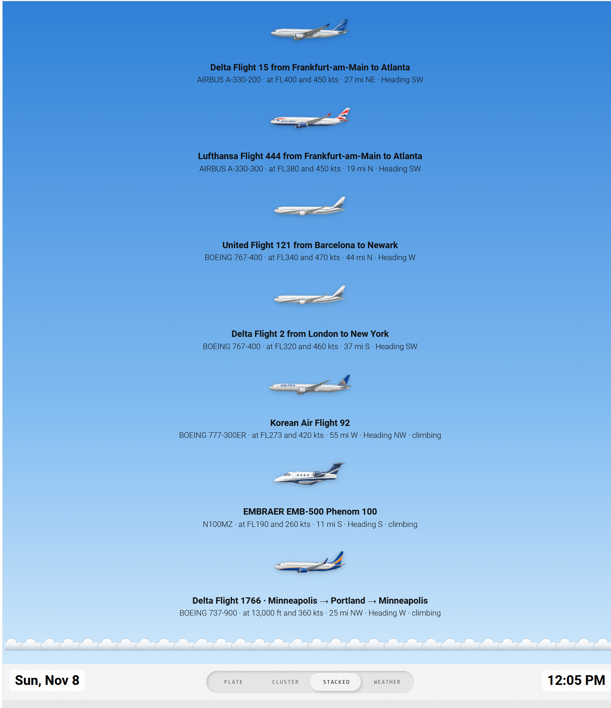
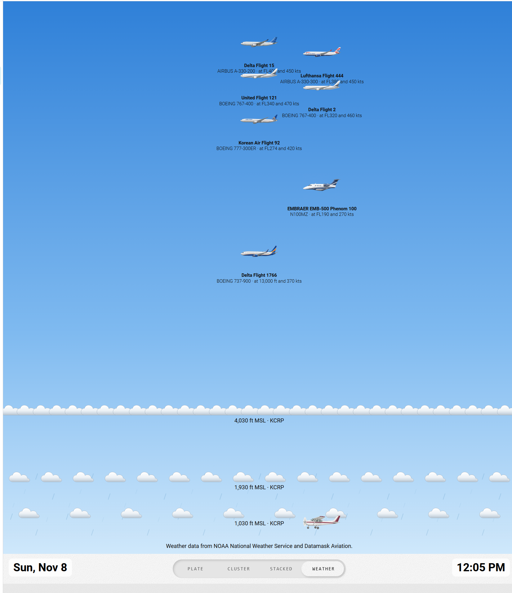

# AeroVisitors
AeroVisitors is a Home Assistant card to show images of aircraft based on ADSB data. The images are AI created, with one for each model of aircraft. These are based on the 'type' field included in the ADSB data. If an aircraft uses a type that is not included in the images, the card will use a generic image. The included default image is Icarus.

The card can use either a direct feed from an ADSB source, or a Home Assistant sensor that pulls data from a feed. Many remote feeds won't allow a web page to pull them in, based on CORS configuration, so this handles that by having the Home Assistant sensor read the data.  A rest.yaml configuration file example is shown below. 

## Installation
 1. Copy the javascript file to /config/www/aero-visitors-card.js
 2. Add /local/aero-visitors-card.js as a JavaScript module resource
 3. Copy the aircraft images in /config/www/aircraft/ with the cloud.svg
 4. Aircraft should be 1200 x 650 roughly. There is so much resizing that hi-rez isn't needed. PNG with transparent background is best
 
 Images are named by ICAO aircraft type:
   A320.png, B738.png, C172.png
 
## Configuration Notes
If you configure a Home Assistant weather entity, the background will updated based on conditions. If you configure a Sun sensor, the background will update based on that to show sunrise/sunset. The weather sensor is not used to show cloud levels. Aviation uses METAR weather data to describe current conditions at the reporting station. These reports include ground level precipitation and cloud layers.  Most airports have a 4 character METAR code. METAR data is generously provided by Datamask Aviation. [Datamask] ( https://datamask.org/ )  Don't remove their attribution if you use their data.

You can use our own ADSB receiver or a public data source like adsb.lol   See https://api.adsb.lol/docs for details and limits on using their data. Note the base 500 requests/day limit.

The Cluster and Stacked views have parameters for scaling aircraft so the differences in aircraft sizes can be display roughly accurately or so that all aircraft display at the same size. The scaling factors are exponential. 

Route data source is configurable, but the parser expects the data to be in the format provided by ADSB.im

The weather (METAR) view gets a messy quickly if there are too many aircraft close together. Work in progress.

## ADSB Sensor Config
```
  - resource: https://api.adsb.lol/v2/lat/40/lon/-70/dist/100
    scan_interval: 600
    timeout: 5
    sensor:
      - name: ADSB Feed LOL
        unique_id: adsb_feed_lol
        value_template: "{{ value_json.ac | length }}"
        json_attributes:
          - now
          - ac
          - msg
 ```
Home Assistant should be configured not to retain the history of this sensor. 
```
recorder:
  exclude:
    entity_globs:
      - sensor.adsb_*
```

## Aircraft Images
gen_aircraft_openai.py is a python file that can be used to generate new images for missing types or to create the images in a different style. aircraft_types.csv shows examples of prompts to create the images.

## Views
The Plate view shows one aircraft.
The Cluster view shows all aircraft in a group. They can be scaled to show size differences or all plans can be shown the same size.
The Stacked view shows all aircraft in a vertical stack, sorted by altitude
The Weather view shows all aircraft in a vertical stack, with data from a METAR weather source showing cloud levels. This shows on one screen and will cause planes and descriptions to overlap if there are many aircraft.  METAR data should come from your nearest airport.
  
   
    
 
## Card Options
These can all be edited in the visual editor. 
```
type: custom:aero-visitors-card
adsb_source: url                                        # ADS-B data source: URL or sensor
adsb_url: http://192.168.0.101:8080/data/aircraft.json  # ADS-B URL; supports {lat}, {lon}, {radius_nm}, {radius_km}, {radius_mi} for feeds that accept 
                                                          those parameters in the URL base
adsb_sensor: sensor.adsb_feed                           # ADS-B sensor with an aircraft or ac array in its attributes; used when 'adsb_source' is sensor. 
                                                          See example config above
latitude: 40                                            # Latitude; omit to use Home Assistant home location. Used when limiting the radius 
                                                          or as a parameter of the ADSB URL.
longitude: -70                                          # Longitude; omit to use Home Assistant home location. 
units: imperial                                         # Distance units: auto, imperial, or metric. Used when limiting the radius.
radius: 300                                             # Limit aircraft to this radius from the configured location, in mi/km, following selected units
refresh_s: 300                                          # Refresh interval in seconds. 

view: cluster                                           # Default view: plate, cluster, stacked, or metar
plate_pick: nearest                                     # Plate view shows one aircraft. This determines which one: nearest, lowest, highest, or fastest
max_aircraft: 15                                        # Maximum aircraft in Cluster, Stacked, and METAR views
max_altitude_ft: 0                                      # Maximum altitude in feet; 0 = no ceiling
show_ground: false                                      # Include aircraft on the ground

cluster_scale: 1                                        # Image scale for Cluster view. 
cluster_text_size: 8                                    # Cluster view base title font size in pixels; scales with aircraft.
size_curve_cluster: 1                                   # Cluster relative size curve: 2.5 ≈ true scale, 1 = some variation, 0 = equal size. 
                                                          Aircraft sizes are based on wingspan. The card hold over 100 common aircraft types. For any aircraft not available, a wingspan is assigned based on ADBS category (e.g. light, small, heavy, rotoctraft ). Aircraft can then be scaled to true proportions, all the same size, or something in between. The scale is logarithmic.
stack_scale: 1                                          # Image scale for Stacked view
stack_text_size: 12                                     # Stacked view base title font size in pixels
size_curve_stacked: 1                                   # Stacked relative size curve: 2.5 ≈ true scale, 1 = some variation, 0 = equal size
show_clock: true                                        # Show clock
show_date: true                                         # Show date

show_title_cluster: true                                # Show title in Cluster view
show_subtitle_cluster: true                             # Show subtitle in Cluster view
show_title_stacked: true                                # Show title in Stacked view
show_subtitle_stacked: true                             # Show subtitle in Stacked view

backdrop: none                                          # Backdrop: 
                                                          white - simple white
                                                          auto - If the weather sensor is configured, current conditions (clear, clouds, rainy, snowy,
                                                                 stormy) are applied. If the sun sensor is configured, sunrise and sunset are applied.
                                                                 Day and night are applied.
                                                          none - grey slightly textured background
                                                          sunset - gradient fill from blue down to orange
                                                          night - dark sky, stars, the moon (phase not included)
                                                          plate - border page with a manila colored background
                                                          image - An image based on configuration below
backdrop_image: /local/smiley_face.jpg                # Backdrop image URL; used when backdrop is 'image' Should be stored on the HA server.
sun_entity: sun.sun                                     # Sun entity for automatic backdrop
weather_entity: weather.XXXXXX                          # Optional weather entity for automatic backdrop

image_path: /local/aircraft                             # Aircraft image folder
image_ext: png                                          # Aircraft image extension: png, webp, jpg, or svg
image_fallback: default                                 # Fallback image name without extension; blank = silhouette
image_faces: left                                       # Artwork base direction: left or right. 
flip_to_heading: true                                   # Flip artwork to match heading: west left, east right
image_blend: normal                                     # Image blend mode: normal or multiply. This is mostly for aircraft images in jpg that have a 
                                                          white background. PNG should have a transparent background

show_info: true                                         # Show aircraft information in Plate view
route_lookup: true                                      # Look up origin/destination cities for aircraft with a flight number.
route_url: http://adsb.im/api/0/routeset                # Route lookup API endpoint; requests are batched every 35 seconds
climb_fpm: 200                                          # Climb/descent threshold in feet per minute. Aircraft are labeled as climbing/descending if their 
                                                          rate of change is greater than this.
operators:                                              # Aircraft operators use a 3 character prefix for flight numbers, e.g. AAL American Airlines,
                                                          BAW British Airways, etc. More than 100 common (in North America) codes are configured. 
                                                          Add entries here to show missing ones like  EJM: Exective Jet Mgmt  One pair per line.
wingspans:                                              # Wingspan overrides in meters. For aircraft that are sized incorrectly, 
                                                          this allows you to override incorrect or missing winspance. e.g. C68A: 22  One entry per line

metar_enabled: true                                     # Pull airport weather (METAR) data from Datamask.org
metar_airport: KBOS                                     # METAR airport ICAO code. Always a 4 character value
metar_airport_elevation_ft: 5                           # Airport elevation in feet above mean sea level. METAR reports in atltitude above ground, 
                                                          aircraft report in altitude above sea level. This provides a conversion.
metar_refresh: 30                                       # METAR refresh interval in minutes; 30–1440
show_clouds_stacked: true                               # Show METAR cloud layers in Stacked view; Required that METAR data is

empty_text: Nothing but Clear Skies                     # Text displayed when no aircraft are overhead
hide_when_empty: false                                  # Hide card when empty


```


 ## Change log
 1.4.0 - Fixed font scaling issues in cluster view. Added The Python script and aircraft description file as examples of how to generate new images. Restrcuted file layout in the repo.
 1.3.0 - Changed calls to look up routes to POST command that run eer 35 seconds to comply with Terms of Service for adsb.im
 1.2.0 - Added support for different font sizes in Cluster and Stacked views. 

 ## Acknowledgments
 This project was inspired by the amazing work of Ted Warner and his Avian Visitors ( https://github.com/Twarner491/AvianVisitors ) project. And by Tesserae's incredible  e-ink panel solution Tesserae ( https://tesserae.ink/ ).  I did all the design work. AI did all the heavy lifting and much of code typing. 
 
